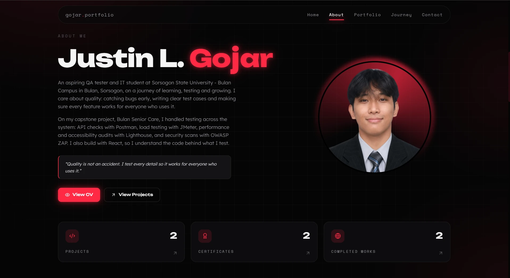

<div align="center">

# Justin L. Gojar — Portfolio

**QA Tester · IT Student · Web Developer**

Personal portfolio built with React and Vite, deployed on Cloudflare.

[](https://gojar-portfolio.pages.dev)
[](https://react.dev)
[](https://vitejs.dev)
[](https://pages.cloudflare.com)



</div>

---

## About Me

I'm an aspiring **QA tester** and **BS Information Technology** student at **Sorsogon State University – Bulan Campus** in Bulan, Sorsogon, Philippines. I care about quality: catching bugs early, writing clear test cases, and making sure every feature works for everyone who uses it.

On my capstone project, **Bulan Senior Care**, I handled testing across the whole system:

| Area | Tool |
| --- | --- |
| API testing | Postman |
| End-to-end testing | Playwright |

I also build with React, so I understand the code behind what I test.

> *"Quality is not an accident. I test every detail so it works for everyone who uses it."*

---

## Featured Projects

### Bulan Senior Care · Full-Stack
A senior-citizen management system for the Office of Senior Citizen Affairs (OSCA) of the LGU of Bulan, Sorsogon. It digitizes senior citizen records and benefits tracking, with a dashboard and role-based access for local government staff.

**Tech:** React · Node.js · MySQL · Vercel · Railway  
[Live Demo](https://bulan-senior-care.vercel.app/) · [Repository](https://github.com/JustinGojar/Bulan_Senior_Care)

### Equalize Gender · Front-End
A gender awareness and inclusion platform on gender-based violence and harassment, built on official Philippine data and laws (RA 9262, RA 9710, RA 11313, RA 11596), with interactive statistics, a myth-or-fact quiz and take-action resources.

**Tech:** React · TypeScript · TanStack Start · Tailwind CSS · Chart.js · Vercel  
[Live Demo](https://equalize-gender.vercel.app/) · [Repository](https://github.com/JustinGojar/Equalize-Gender)

---

## Tech Stack

| Category | Technologies |
| --- | --- |
| **Testing** | Postman · Playwright |
| **Frontend** | React · JavaScript · TypeScript · HTML · CSS · Tailwind CSS · Vite |
| **Backend & Data** | Node.js · Express · PHP · Laravel · MySQL · Supabase |
| **Tools & Deployment** | Git · GitHub · Vercel · Railway · Netlify · Cloudflare · Figma · Claude Code · Codex |

---

## Site Features

- **Intro splash** and a draggable **lanyard ID card** on the hero
- **About** section with profile, quote and quick stats
- **Portfolio** with tabs for Projects, Certificates and Tech Stack, plus a detail page per project
- **Journey** timeline for education and experience
- **Contact form** that stores messages in Cloudflare KV
- **Comment wall** shared with every visitor
- **Admin page** (`/admin`, password-protected) to read messages and moderate comments
- Installable **PWA** with app icons and a service worker
- Fully responsive black and neon-red theme

---

## Project Structure

```
├── docs/               README preview image
├── functions/api/      Cloudflare Pages Functions (messages, comments)
├── server/             Helpers shared by the functions (admin auth, JSON responses)
├── public/             Static assets: avatar, project images, certificates, icons, service worker
├── src/
│   ├── components/     React components (Hero, About, Portfolio, Journey, Contact, Admin…)
│   │   └── TechIcon.jsx  Logos for the Tech Stack tab and social links
│   ├── data.js         All site content: profile, projects, certificates, tech stack, socials
│   ├── App.jsx
│   └── styles.css      Theme colors as CSS variables (--red, --bg, …)
├── index.html
├── vite.config.js
└── wrangler.jsonc      Cloudflare deployment config
```

---

## Getting Started

**Requirements:** Node.js 18 or newer

```bash
git clone https://github.com/JustinGojar/My-Portfolio.git
cd My-Portfolio
npm install
npm run dev        # http://localhost:5173
```

| Command | Description |
| --- | --- |
| `npm run dev` | Start the development server |
| `npm run build` | Build production files into `dist/` |
| `npm run preview` | Preview the production build locally |

### Editing content

Everything shown on the site comes from **`src/data.js`**:

- **Profile:** name, roles, about text, quote, CV link and email
- **Projects:** add images to `public/projects/` and set each project's `image`, `live` and `repo`
- **Certificates:** add scans to `public/certificates/` and list them in `certificates`
- **Tech stack:** add an entry to `techStack`; its `icon` key must exist in `src/components/TechIcon.jsx`
- **Socials:** update URLs and handles in `socials`
- **Colors:** edit the CSS variables at the top of `src/styles.css`

---

## Deployment (Cloudflare)

The contact form and comments use Cloudflare Pages Functions backed by a KV namespace. One-time setup in the Cloudflare dashboard:

1. **Storage & Databases → KV → Create** a namespace (e.g. `portfolio-messages`).
2. **Workers & Pages → gojar-portfolio → Settings → Bindings → Add → KV namespace**: variable name `MESSAGES`, select the namespace (Production, and Preview if needed).
3. **Settings → Variables and secrets → Add**: type **Secret**, name `ADMIN_PASSWORD`, value your password.
4. Redeploy (Deployments → latest production → Retry deployment).

Test the functions locally:

```bash
npm run build && npx wrangler pages dev dist --kv MESSAGES --binding ADMIN_PASSWORD=test
```

---

## Contact

<p>
  <a href="mailto:gojarjustinofficial@gmail.com"></a>
  <a href="https://github.com/justingojar"></a>
  <a href="https://www.linkedin.com/in/justin-gojar-4b88583b3"></a>
  <a href="https://www.facebook.com/gojar.justin"></a>
  <a href="https://t.me/parzival609"></a>
</p>

📍 Bulan, Sorsogon, Philippines

---

<div align="center">
<sub>© 2026 Justin L. Gojar. All rights reserved.</sub>
</div>
